# ConnSmith

Terminal client for network engineers on Windows 11 (64-bit). Tabbed SSH, Telnet and serial consoles, a shared session library, highlighted device output, command broadcast across tabs, and built-in TFTP, FTP and SFTP/SCP servers.

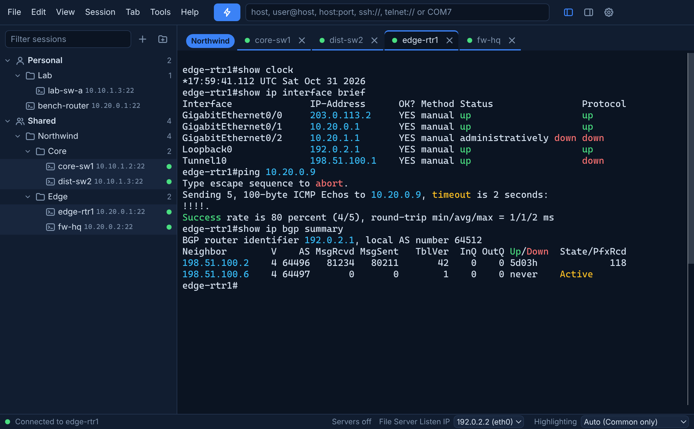

This repository publishes the installers only. Download them from the [Releases page](https://github.com/CautiousCapsLock/connsmith-releases/releases/latest).

**Status:** in testing. Features marked **(0.1.5)** are built on the development branch and arrive in the next release.

## Contents

- [Install](#install) and [Updates](#updates)
- [Getting started](#getting-started)
- Core features: [SSH](#ssh-modern-and-legacy-profiles), [Serial](#serial-console), [Session tree and Shared sessions](#session-tree-and-shared-sessions), [Tabs and tab groups](#tabs-and-tab-groups), [Command window](#command-window-015), [Highlight rules](#highlight-rules), [Find](#find), [File servers](#file-servers-tftp-ftp-and-sftpscp-015), [SecureCRT import](#securecrt-import), [SSH keys](#ssh-keys-including-putty-ppk)

---

## Install

1. Download `ConnSmith-Setup.exe` from the [latest release](https://github.com/CautiousCapsLock/connsmith-releases/releases/latest).
2. Run it. The installer is not code-signed, so Windows SmartScreen can show a warning. Select **More info**, then **Run anyway**.
3. Follow the wizard. The install is per user and needs no administrator rights. The Start menu shortcut is on by default and the desktop shortcut is off.
4. Leave **Launch ConnSmith** ticked on the last page.

The uninstaller asks whether to keep ConnSmith settings. Unticked, it removes `%APPDATA%\ConnSmith`.

### Updates

ConnSmith checks for a new release a few seconds after it starts and every 6 hours. A new release puts a red dot on the Settings cog in the top right corner.

1. Select the cog. It opens **Settings > Updates**.
2. Review **What's new** and select **Download update**.
3. When the download finishes, select **Restart to update**. This closes ConnSmith and every open connection, installs the update and starts the new version.

Nothing downloads or installs without a click. The automatic check can be turned off on the same page. The **Dev builds** switch offers pre-releases for testing and is off by default.

---

## Getting started

### First launch

A welcome window asks for the folder that holds saved sessions (the Personal store). The default is a `ConnSmith` folder in Documents, which OneDrive syncs between a user's own PCs. **Use this folder** accepts it.

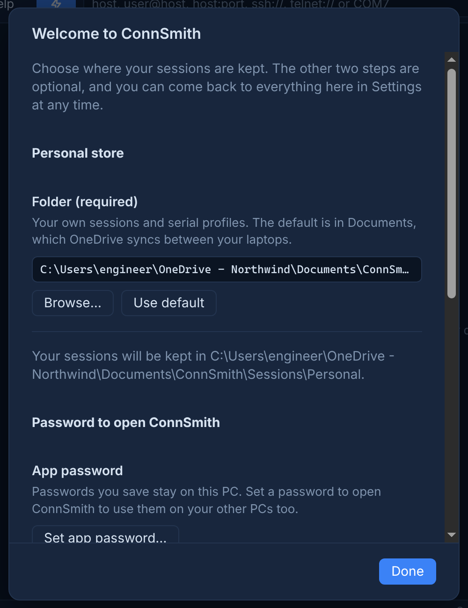

Two optional settings follow. Both can be changed later in **Settings**.

- **App password** (Settings > Security). Required at every start, before any session loads. It protects passwords saved in sessions and makes them usable on other PCs that share the same app password. Without it, saved passwords are readable on the PC that saved them only.
- **Windows Hello.** With an app password set, Windows Hello (fingerprint, face or PIN) can unlock ConnSmith instead of the typed password.

### Connect to a device

**Alt+Q** opens Quick Connect. The connect bar at the top accepts `host`, `user@host`, `host:port`, `ssh://host`, `telnet://host` and `COM7`.

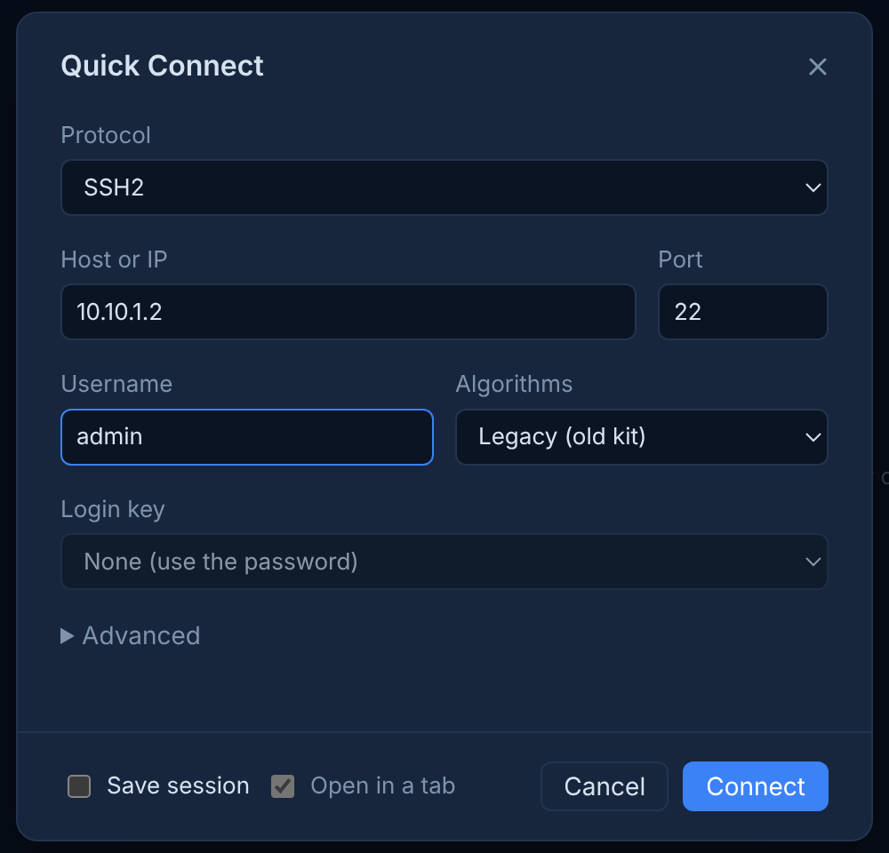

1. Select the protocol (SSH2, Telnet or Serial), enter the host and username, and select **Connect**.
2. On the first connection to a device, ConnSmith shows its host key fingerprint. Select **Trust and connect** after checking it.
3. Enter the password. The tab opens.

**Save session** in Quick Connect, or **Save session…** in a tab's right-click menu, stores the session. The save dialog proposes a name read from the device prompt.

### Saved and shared sessions

Saved sessions appear in the session tree on the left. Double-click opens one. Two stores are shown together:

- **Personal:** the user's own sessions.
- **Shared:** a team folder synced with OneDrive, normally a SharePoint library. See [Session tree and Shared sessions](#session-tree-and-shared-sessions).

---

## Core features

### SSH, Modern and Legacy profiles

SSH-2 with password, keyboard-interactive and public key authentication. Each session uses one of two algorithm profiles:

- **Modern** (default): current algorithms only.
- **Legacy**: adds `ssh-rsa`, CBC and 3DES ciphers, SHA-1 MACs and `diffie-hellman-group14-sha1`, which older switches require.

When a Modern connection fails because the device offers only older algorithms, ConnSmith lists what the device offers and shows **Switch to Legacy and reconnect**. The button saves Legacy to the session and reconnects. Enter activates it.

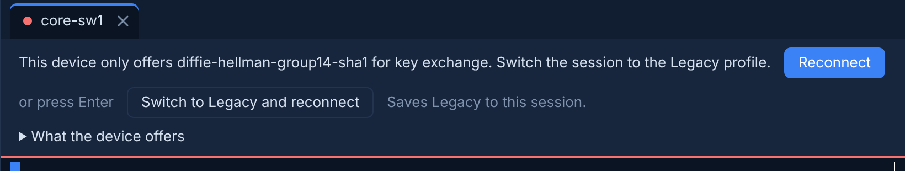

Also included: host key verification against a known-hosts file, keepalives, a **Reconnect** button after a dropped link, and the negotiated algorithms in the connection info panel (top right icon).

**Known limitation:** devices that offer only `diffie-hellman-group1-sha1` (for example older Cisco IOS releases) cannot connect. The tab reports this.

### Serial console

COM ports are scanned every 2 seconds. When a USB console adapter is plugged in, a notification offers to open it at **9600** or **115200** baud.

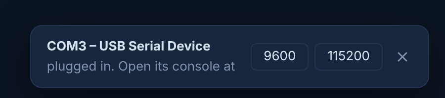

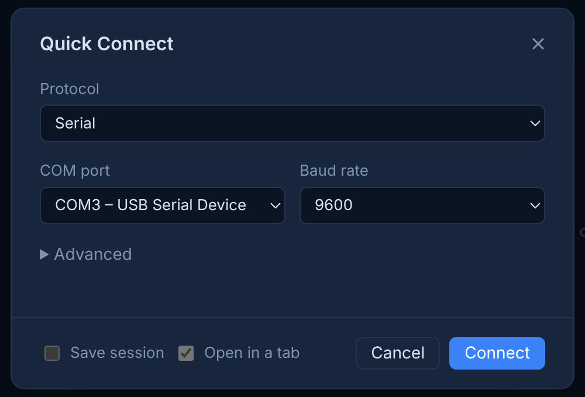

- **Send Break** in the tab menu, for ROMMON and password recovery.
- Newline and local echo options per session.
- Serial profiles are stored in the Personal store only, never in Shared.
- A tab reconnects automatically when the same USB adapter is plugged back in.

### Session tree and Shared sessions

A single tree shows the Personal and Shared stores with their folders. The filter box searches name, host and folder. Sessions can be dragged between folders and between stores.

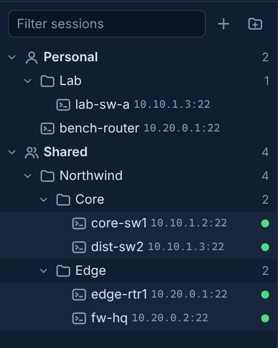

- **Status dots (0.1.5):** a saved session with an open tab shows a dot at the right of its row: green connected, amber connecting, red disconnected.
- **Multi-connect:** Ctrl+click or Shift+click selects several sessions, and Enter opens each in its own tab. Host key and password prompts appear one after another.
- **Shared store:** set the team folder in **Settings > Session stores**. Each user enters the same shared password once on their own PC. Shared sessions are organised by client and category.
- **Move to Shared:** the right-click menu on a session or folder moves it to the Shared store after the share checks. A session that fails a check stays in Personal and the dialog gives the reason. **Session > Move many to Shared…** moves many sessions in one wizard.
- **OneDrive:** the tree shows a warning when shared files are online-only placeholders. The folder must be set to **Always keep on this device** in File Explorer.

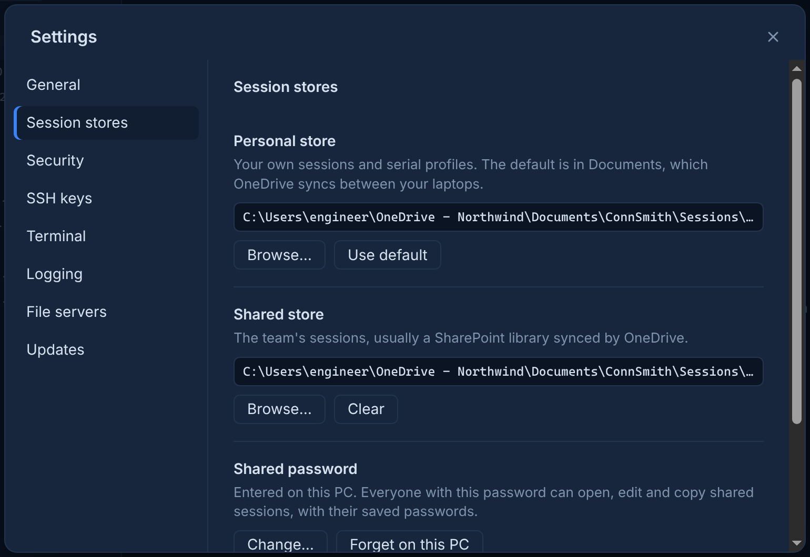

### Tabs and tab groups

Each connection opens in a tab. Tabs reorder by drag. **Move tab to new window** detaches a tab together with its connection and scrollback. The tab menu also closes other tabs or the tabs to the right.

**Tab groups (0.1.5)** keep the devices for one task together. **Connect as tab group…** in the tree's right-click menu opens the selected sessions as a named, coloured group, shown as a chip before its tabs. Selecting the chip folds the group. **Add to new group…** in a tab's menu groups tabs that are already open.

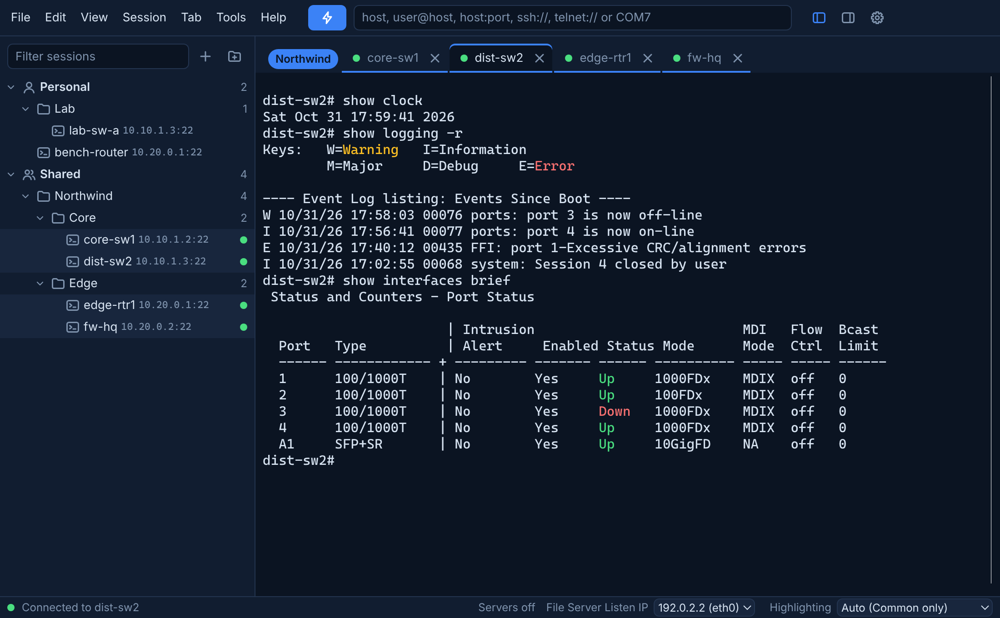

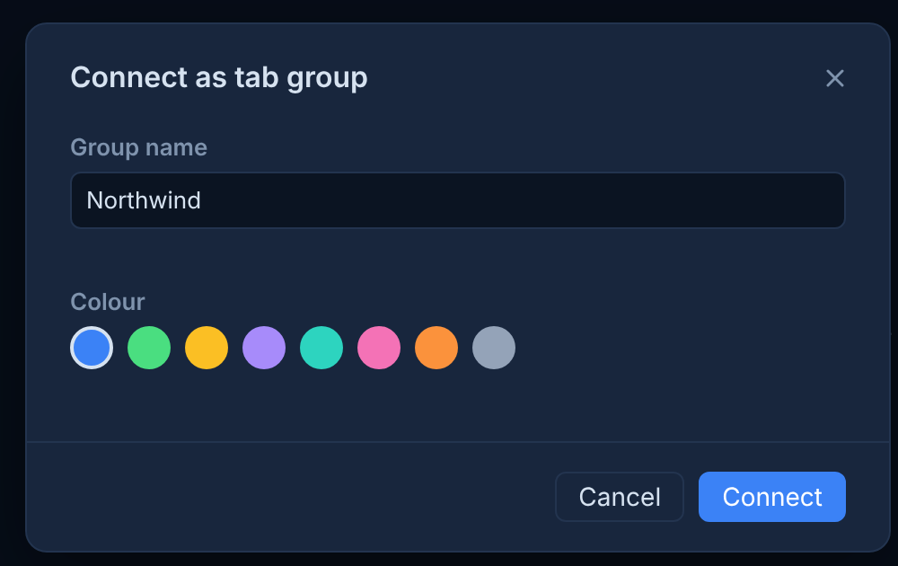

### Command window (0.1.5)

**View > Command window** opens an input box at the bottom of the window. Its target is one of:

- the visible tab,
- the tab group of the visible tab,
- all active sessions.

The radio buttons name the target and the number of tabs, for example `Tab group: Northwind (4)`. Enter sends. Shift+Enter adds a line. Up and Down recall earlier commands. **Wait for the prompt after each line** holds each line until the device prompt returns. Disconnected tabs are skipped and the window reports how many.

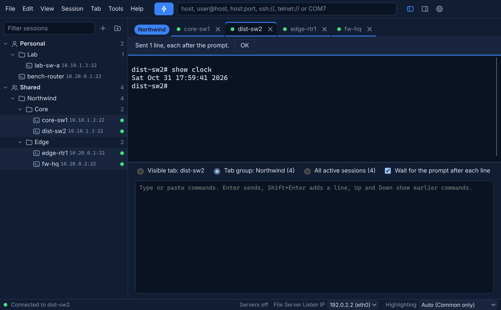

### Highlight rules

Device output is coloured as it arrives. Rules cover IP addresses, interface up and down states, warnings and errors, ping loss, BGP and OSPF neighbour states, `[confirm]` prompts, and `reload` and `erase`. Rule sets exist for Cisco, Comware, Aruba and FortiOS, plus a common set that always applies.

The rule set is selected from the device's output. The **Highlighting** menu in the status bar shows the active set and switches it.

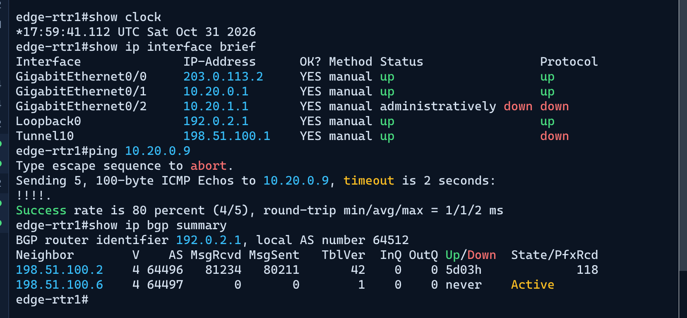

### Find

**Ctrl+Shift+F** searches the scrollback of the current tab, with case-sensitive and regular expression options. **(0.1.5)** Every match is also marked in a strip beside the scrollbar, showing where matches fall in a long output.

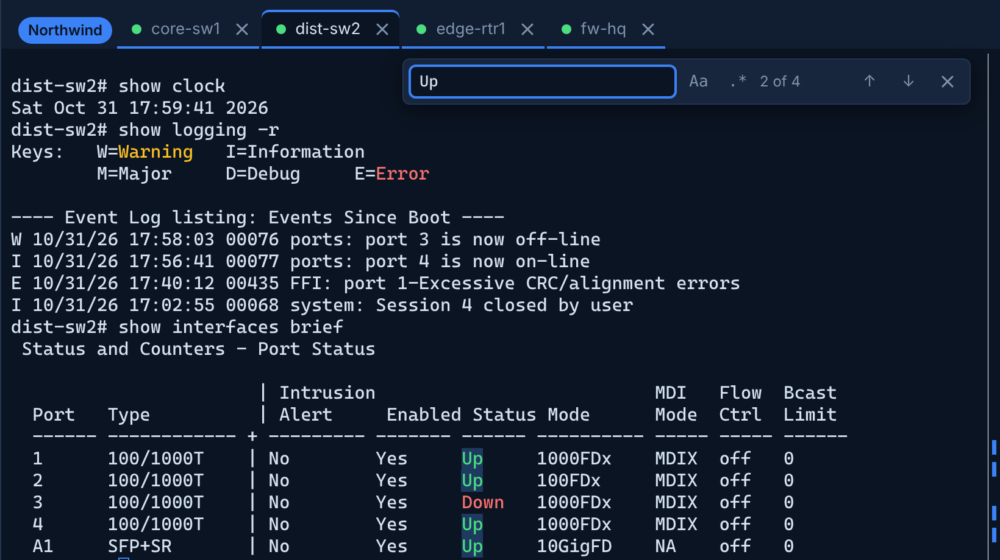

### File servers: TFTP, FTP and SFTP/SCP (0.1.5)

**Tools > File servers** opens a panel with three servers that serve one shared folder (the Downloads folder by default, changed in **Settings > File servers**).

| Server | Port | Typical use |
| --- | --- | --- |
| TFTP | UDP 69 | Firmware and configuration transfer for switches and access points |
| SCP / SFTP | TCP 22 (2222 if 22 is in use) | Devices that use `scp` or `sftp`, such as FortiGate |
| FTP | TCP 21 (passive range 50000-50100) | Devices that support FTP only, such as Cisco `copy ftp:` |

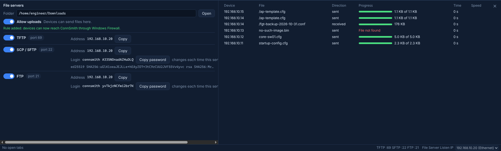

- The **File Server Listen IP** in the status bar selects the address the servers bind to, or **All interfaces**.
- The panel shows each server's address and, for SFTP and FTP, the login and a password generated each time the server is switched on.
- The folder is read-only until **Allow uploads** is switched on. The switch resets at every start. Devices cannot delete files or directories.
- Each transfer is listed with device, file, progress and speed. Refused requests are listed with the reason.
- **Allow in Windows Firewall** adds inbound rules for these ports only, after one administrator prompt. Where policy prevents this, the panel shows the equivalent `netsh` command.

### SecureCRT import

**File > Import SecureCRT sessions…** reads the SecureCRT sessions folder and shows its folders and SSH and Telnet sessions as a tree of tick boxes. The ticked sessions are added to the Personal store with the same folder structure. SecureCRT's own files are not modified, and sessions that already exist in ConnSmith are not changed.

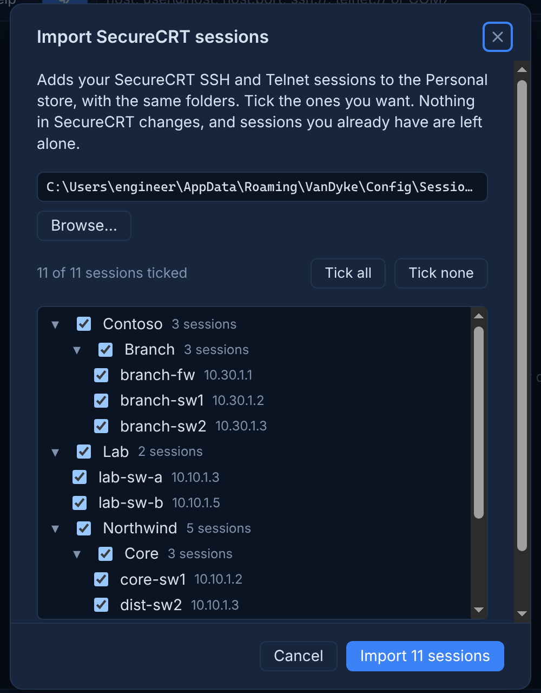

The final page offers **Move to Shared…**, which opens the wizard that assigns a client and category to each folder and moves the sessions that pass the share checks.

### SSH keys, including PuTTY .ppk

**Settings > SSH keys > Add key…** accepts OpenSSH and PEM private keys and PuTTY `.ppk` files: version 2 RSA, and version 3 (PuTTY 0.75 and later) RSA, ECDSA and ed25519 **(0.1.5)**, with or without a passphrase. No conversion in PuTTYgen is needed.

Keys stay in their original files and are never copied into sessions or the Shared store. A session selects a key by name in **Edit session**. The key is tried first, and the password prompt follows if the device refuses it.

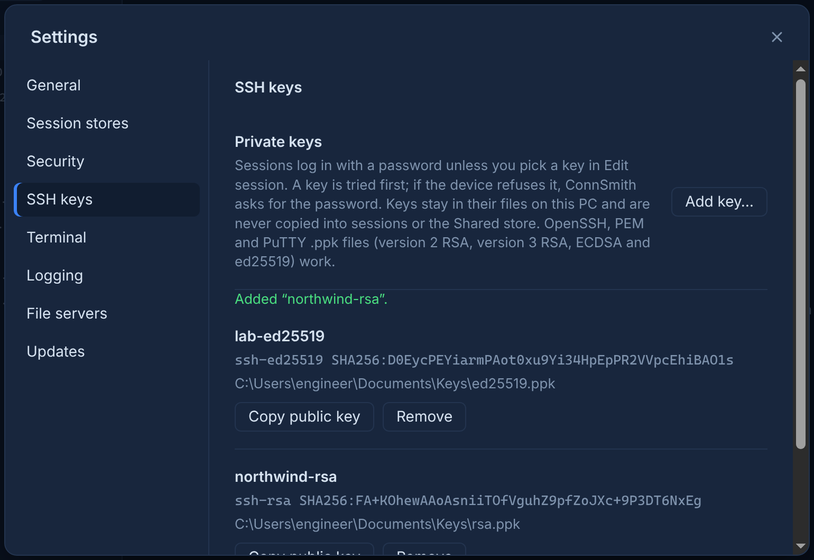

---

## Other features

- **Session logging** to a file with a templated path and optional timestamps, started from the tab menu or automatically per session.
- **Paste protection:** pastes are shown for confirmation first and can be sent line by line with per-session line and character delays.
- **Hostname check:** when the device prompt differs from the saved session name, ConnSmith offers to update the session.
- **Command palette** for all menu actions.

## Reporting problems

Send issues to Matt with the ConnSmith version, shown in **Settings > Updates**.
