# ConnSmith

Terminal client for network engineers on Windows 11 (64-bit). Tabbed SSH, Telnet and serial consoles, a shared session library, highlighted device output, split view, a command window that sends to several tabs at once, SSH port forwarding and key generation, and built-in TFTP, FTP and SFTP/SCP servers.

This repository publishes the installers only. Download them from the [Releases page](https://github.com/CautiousCapsLock/connsmith-releases/releases/latest).

**Status:** in testing. The latest stable release is 0.2.0.

## Contents

- [Install](#install) and [Updates](#updates)
- [Getting started](#getting-started)
- Core features: [SSH](#ssh-modern-and-legacy-profiles), [Port forwarding](#port-forwarding-02), [Serial](#serial-console), [Session tree and Shared sessions](#session-tree-and-shared-sessions), [Searching sessions](#searching-sessions), [Tabs, tab groups and split view](#tabs-tab-groups-and-split-view), [Command window](#command-window), [Highlight rules](#highlight-rules), [Terminal appearance](#terminal-appearance), [Find](#find), [File servers](#file-servers-tftp-ftp-and-sftpscp), [SecureCRT import](#securecrt-import), [SSH keys](#ssh-keys)
- [New session and Edit session](#new-session-and-edit-session), [Other features](#other-features), including the [Jump host](#jump-host)

---

## Install

1. Download `ConnSmith-Setup.exe` from the [latest release](https://github.com/CautiousCapsLock/connsmith-releases/releases/latest).
2. Run it. The installer is not code-signed, so Windows SmartScreen can show a warning. Select **More info**, then **Run anyway**.
3. Follow the wizard. The install is per user and needs no administrator rights. The Start menu shortcut is on by default and the desktop shortcut is off.
4. Leave **Launch ConnSmith** ticked on the last page.

The uninstaller asks whether to keep ConnSmith settings. Unticked, it removes `%APPDATA%\ConnSmith`.

### Updates

ConnSmith checks for a new release a few seconds after it starts and every 6 hours. A new release puts a red dot on the Settings cog in the top right corner.

1. Select the cog. It opens **Settings > Updates**.
2. Review **What's new** and select **Download update**.
3. When the download finishes, select **Restart to update**. This closes ConnSmith and every open connection, installs the update and starts the new version. The installer shows its progress and the step it is on until the new version opens.

Nothing downloads or installs without a click. The automatic check can be turned off on the same page. The **Dev builds** switch offers pre-releases for testing and is off by default.

---

## Getting started

### First launch

A welcome window of four short steps starts with the folder that holds saved sessions (the Personal store). The default is a `ConnSmith` folder in Documents. **Next** saves it. The steps are Personal folder, app password, Shared folder and Shared password. Next and Finish wait, with a line saying why, while a password form is open and unsaved.

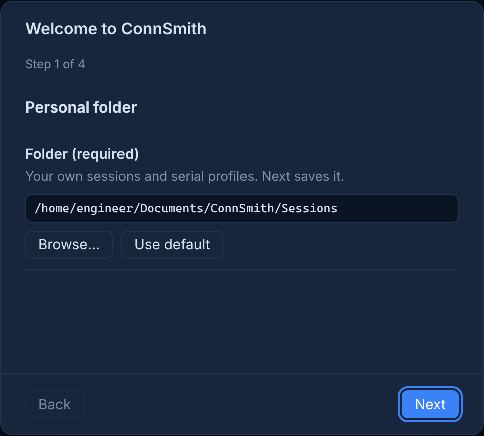 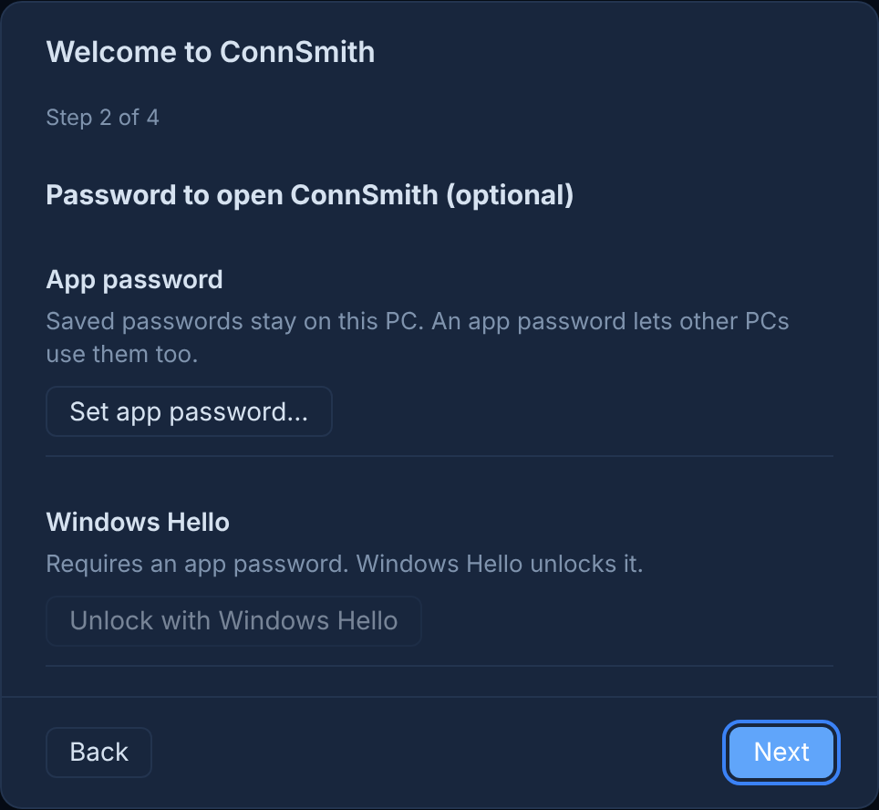

The app password and the Shared folder are optional, and both can be changed later in **Settings**.

- **App password** (Settings > Security). Required at every start, before any session loads. It protects passwords saved in sessions and makes them usable on other PCs that share the same app password. Without it, saved passwords are readable on the PC that saved them only.
- **Windows Hello.** With an app password set, **Settings > Security** can turn on unlock with Windows Hello (fingerprint, face or PIN) instead of the typed password. The Hello prompt appears as soon as ConnSmith opens. Cancel it to type the app password. Hello is built into ConnSmith and starts no scripts. The setting is per PC, so a second PC needs the app password typed once before Hello is turned on there. Uninstalling ConnSmith switches Hello off, even if the settings are kept.
- **Shared folder and password.** Steps 3 and 4 pick the team's Shared folder and enter the shared password. **Skip Shared** leaves the Shared store off for now. A chosen Shared folder cannot be finished until its shared password is saved.

### Connect to a device

**Alt+Q** opens Quick Connect. The connect bar at the top accepts `host`, `user@host`, `host:port`, `ssh://host`, `telnet://host` and `COM7`.

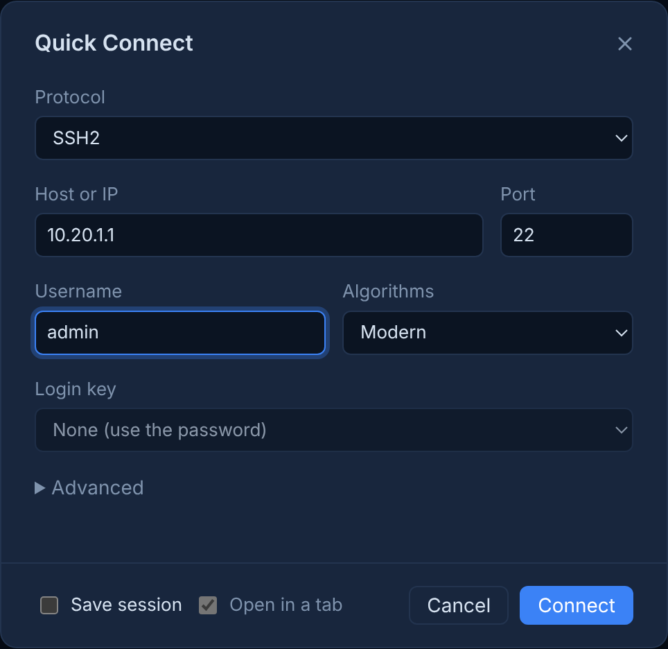

1. Select the protocol (SSH2, Telnet or Serial), enter the host and username, and select **Connect**.
2. On the first connection to a device, ConnSmith shows its host key fingerprint. Select **Trust and connect** after checking it.
3. Enter the password. The tab opens.

**Save session** in Quick Connect, or **Save session…** in a tab's right-click menu, stores the session. The save dialog proposes a name read from the device prompt.

### Saved and shared sessions

Saved sessions appear in the session tree on the left. Double-click opens one. Two stores are shown together:

- **Personal:** the user's own sessions.
- **Shared:** a folder that the whole team can access. See [Session tree and Shared sessions](#session-tree-and-shared-sessions).

---

## Core features

### SSH, Modern and Legacy profiles

SSH-2 with password, keyboard-interactive and public key authentication. Each session uses one of two algorithm profiles:

- **Modern** (default): current algorithms only.
- **Legacy**: adds `ssh-rsa`, CBC and 3DES ciphers, SHA-1 MACs and `diffie-hellman-group14-sha1`, which older switches require.

When a Modern connection fails because the device offers only older algorithms, ConnSmith lists what the device offers and shows a yellow **Switch to Legacy algorithms and reconnect** button. The button saves Legacy to the session and reconnects. Enter activates it. **What the device offers** expands the full list.

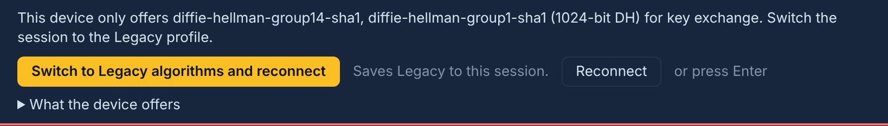

Also included: host key verification against a known-hosts file, keepalives, a **Reconnect** button after a dropped link, and the negotiated algorithms in the connection info panel (top right icon). For a device whose host key is already saved, ConnSmith asks for that key type first, as OpenSSH does, so a device that has since gained a newer key type does not show a first-connection dialog.

**Known limitation:** devices that offer only `diffie-hellman-group1-sha1` (for example older Cisco IOS releases) cannot connect. The tab reports this.

### Port forwarding

An SSH session can open local port forwards when it connects, like `ssh -L`. A forward opens a port on the PC and passes connections through the device to a remote host and port. Typical use: reach a switch's own web page.

Set forwards in **Edit session > Advanced > Port forwards**. Each row has a local port, a remote host and a remote port. For the device's own web page, use remote host `127.0.0.1`. While the session is connected, browse to `127.0.0.1:<local port>`.

- Forwards open with the connection and close with it. A forward that cannot start, for example because the local port is in use, is reported in the tab.
- Up to 20 forwards per session. Forwards work through a [jump host](#jump-host).
- Forwards are saved in the session file.

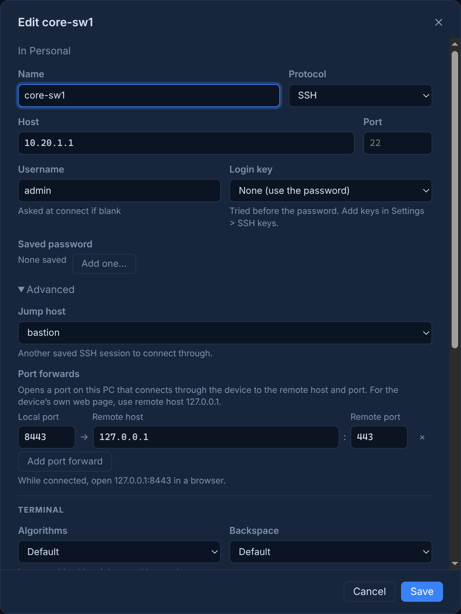

### Serial console

COM ports are scanned every 2 seconds. When a USB console adapter is plugged in, a notification offers to open it at **9600** or **115200** baud.

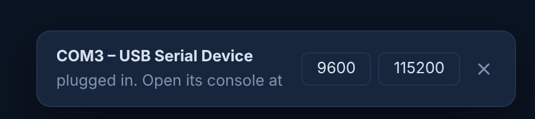

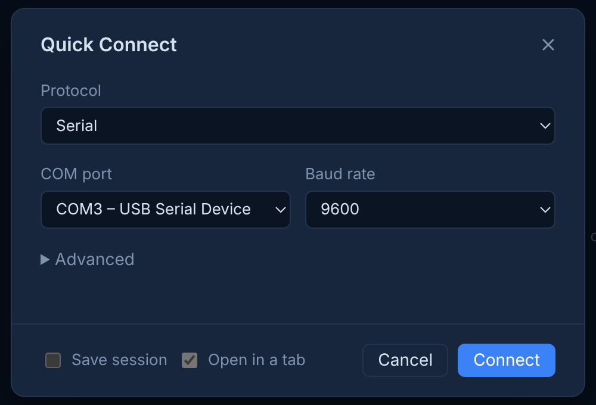

- **Send Break** in the tab menu, for ROMMON and password recovery.
- Newline and local echo options per session.
- Serial profiles are stored in the Personal store only, never in Shared.
- A tab reconnects automatically when the same USB adapter is plugged back in.

### Session tree and Shared sessions

A single tree shows the Personal and Shared stores with their folders. The filter box searches name, host and folder. Sessions can be dragged between folders and between stores. Pick several sessions with Ctrl or Shift and drag any one of them: they all move. The right-click **Move…** opens a window of folders for one session or several, in Personal and in Shared. A session that can't move stays put and is named in a banner.

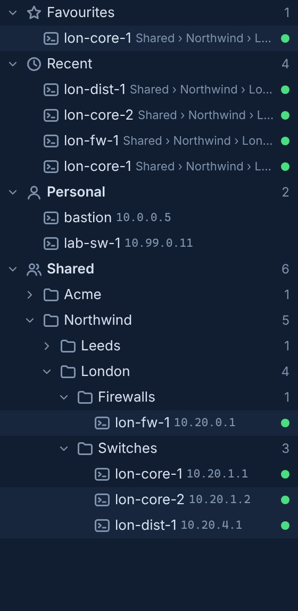

- **Status dots:** a saved session with an open tab shows a dot at the right of its row: green connected, amber connecting, red disconnected.
- **Multi-connect:** Ctrl+click or Shift+click selects several sessions, and Enter opens each in its own tab. Host key and password prompts appear one after another. With several sessions selected, the right-click menu also offers **Move to Shared…** and **Delete N sessions…**. Delete lists the sessions and asks first.
- **Collapse all:** the right-click menu of every folder, and of the Personal and Shared rows, folds the tree. ConnSmith remembers which folders were open.
- **Copy IP, Copy username and Copy password:** in the right-click menu of a saved session. The clipboard is cleared 30 seconds after a password is copied.
- **Slow files:** a session file that does not open within a few seconds, for example on a slow network share, is listed as "not opened yet…" and loaded when it opens. It is never offered for deletion while it waits.
- **Shared store:** set the team folder in **Settings > Session stores**. Each user enters the same shared password once on their own PC.
- **Move to Shared:** the right-click menu on a session or folder moves it to the Shared store after the share checks. A session that fails a check stays in Personal and the dialog gives the reason. **Session > Move many to Shared…** moves many sessions in one wizard. The wizard's last step lists the Personal folders the move left empty, each with a tick box that is on to start with, and deletes the ones that stay ticked.
- **Unshared sessions:** **Session > Unshared sessions** lists Personal sessions with a host that is not in Shared, so they can be shared or deleted in batches.

#### The Shared folder

The Shared store is a normal folder that the whole team can read and write: a network share, a folder on a file server, or a synced folder. ConnSmith keeps one file per session, so it needs no server. Every user needs read and write access to the folder.

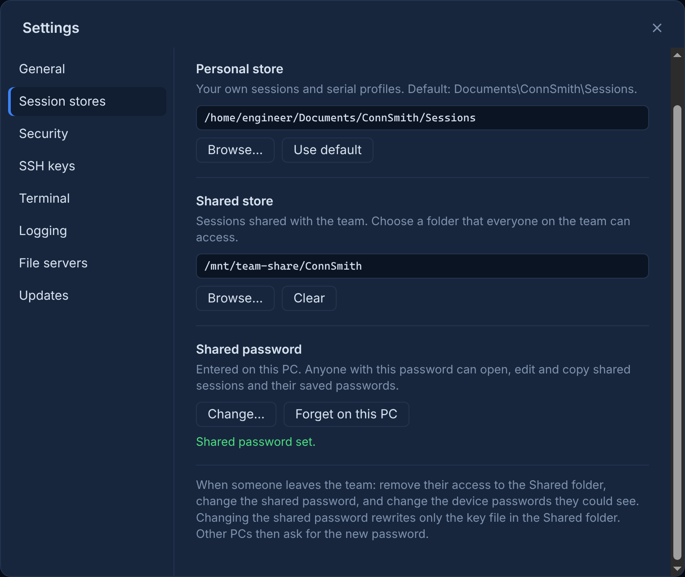

- Each person enters the shared password once on each PC. It unlocks the Shared store and the passwords saved in shared sessions.
- Anyone with the shared password can open, edit and copy shared sessions, including their saved passwords.
- When someone leaves the team: remove their access to the Shared folder, change the shared password, and change the device passwords they could see. Changing the shared password rewrites only the key file in the Shared folder.

#### Shared folder layout

Shared sessions follow one layout: **Client**, an optional **Site**, then a device type folder (**Firewalls**, **Switches**, **VoIP**, **Wireless** or **Other**), then the sessions.

- A client's right-click menu has **New site folder…** and **New device folder…**. A site's menu has **New device folder…** only. A client and each of its sites can hold the same device types. **New device folder…** lists every device type and greys out the ones the client or site already has.
- **Move to Shared** asks for client, site and device type. The client and site boxes list the ones already in Shared, and a line under each says what a typed name will do. The wizard guesses the site from a folder such as `Acme/London/Switches`.
- Nothing is created ahead of time. Device type folders cannot be renamed.
- Folders and sessions already in Shared that do not fit the layout are flagged with a warning and a **Review** button that lists them. Nothing is moved or hidden.
- Deleting a Shared folder asks twice, because it removes the folder for everyone. The confirmation says how many sessions go with it.
- A team that keeps its own `_rules.json` lists its device types there. Add `Wireless` to use that type.

#### Duplicate checks

The Shared store is edited by several people, so ConnSmith checks for the same thing being added twice. The checks ignore case, spaces and punctuation, so `Core SW1` and `core-sw1` match. A short host name and the same name with a domain, or one IPv6 address written two ways, count as the same device. A device only matches within its own client, so the same private address under two clients is not a duplicate.

- **Folders:** a new or renamed client or site folder that matches one beside it is refused. One that is only close (`Acme` and `Acme Ltd`, or a one-letter typo) asks once more, and the button becomes **Create anyway**.

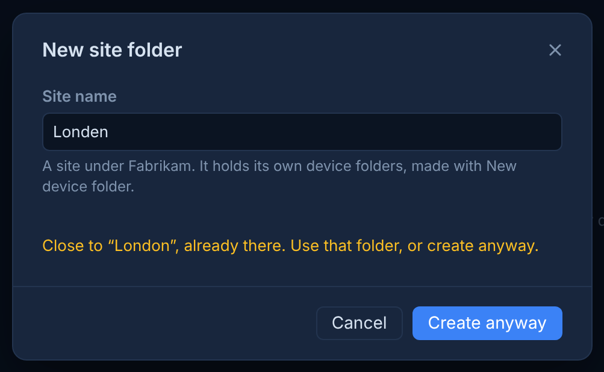

- **Sessions:** when a session being moved to Shared has the same device as one already there, the dialog lists the existing sessions with **Open** and **Edit** buttons, and the button becomes **Move anyway**. The wizard has a **Move anyway** tick box on each such session. A failed name or host check still blocks the move.

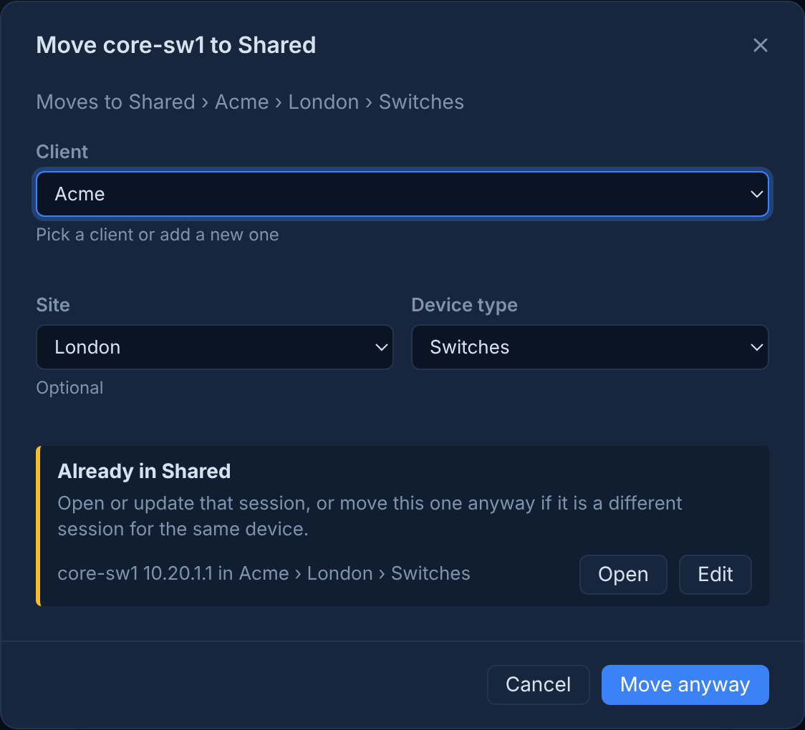

- **Possible duplicates banner:** when duplicates are already in the store, for example because two people shared the same device at once, the tree shows **N possible duplicates in Shared** with a **Review** button. Nothing is changed automatically: delete or rename one from the tree, or leave both if both are wanted.

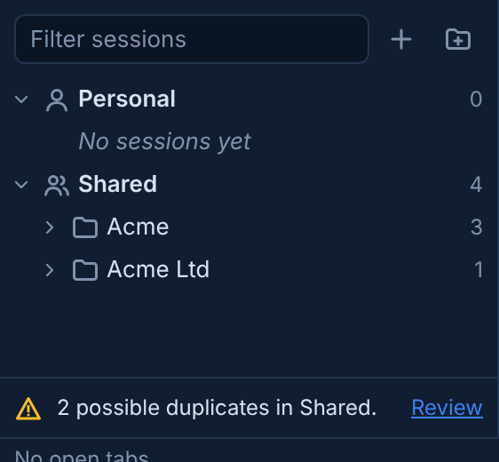

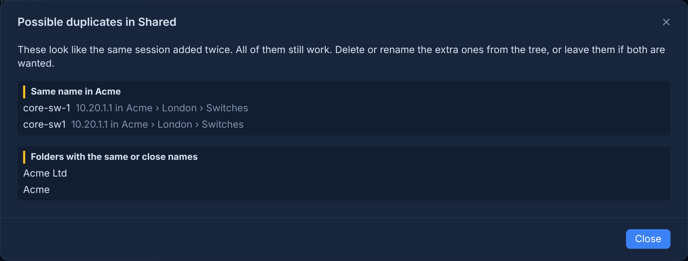

- **Empty folders:** after the last session leaves a Shared device folder (deleted, or moved to Personal or another Shared folder), ConnSmith asks **Delete the empty folder…?**. A client or site folder that the removal would also empty is included. Each folder has a tick box, all ticked to start with: untick one to keep it. A folder that holds one you kept stays too. With none ticked the button reads **Keep all** and deletes nothing. ConnSmith never deletes on its own, so a colleague who is about to add to the folder can keep it.

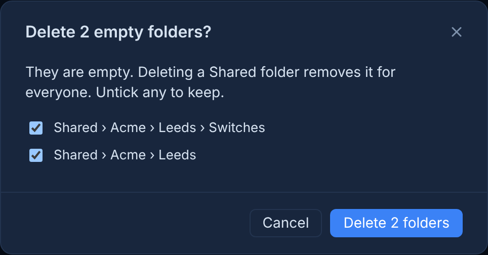

### Searching sessions

- **Title-bar box:** type part of a session's name, address, client or site and pick it from the list that drops down. Typos are forgiven: `lodnon` finds London. Typing a host still works: it is the last row of the list. **Alt+K** jumps to the box. **Alt+Q** still opens Quick Connect.
- **Session filter:** the filter box above the tree shows how many sessions match (for example "6 of 412"), has a clear button, and marks the words typed in the matching names, addresses and folders. **All**, **Shared** and **Personal** buttons under it limit the search to one store.
- **Favourites and Recent:** right-click a session and choose **Add to Favourites**. Favourites and Recent sit above Personal and Shared. Recent lists the last 8 sessions opened. Both lists belong to the user and are kept on that PC, not in the Shared folder. **Settings > General** hides Recent.
- **Focus on one client:** right-click a client in Shared and choose **Focus on this client** to show only that client's sites and devices. Personal stays where it is. **Switch** picks another client and **Show all** brings the rest back.

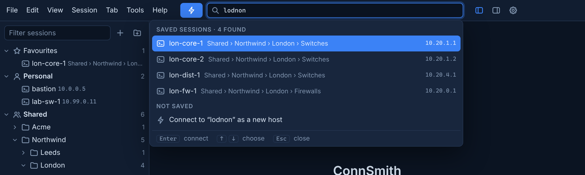

### Tabs, tab groups and split view

Each connection opens in a tab. Tabs reorder by drag. **Move tab to new window** detaches a tab together with its connection and scrollback. The tab menu also closes other tabs or the tabs to the right. **Clone session** opens the same session again in a new tab next to the first, in the same group. A serial port can only be opened once, so it cannot be cloned.

**Tab groups** keep the devices for one task together. **Connect as tab group…** in the tree's right-click menu opens the selected sessions as a named, coloured group, shown as a chip before its tabs. Selecting the chip folds the group. **Add to new group…** in a tab's menu groups tabs that are already open. Dragging a tab onto a group's chip, or onto any tab of the group, adds it, and the group lights up in its colour while the tab is held over it.

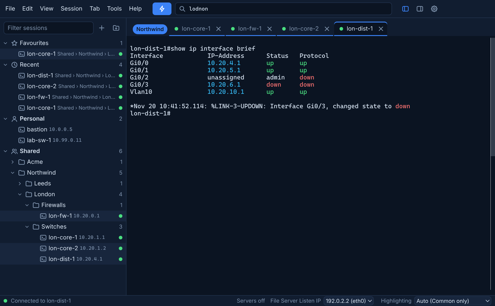

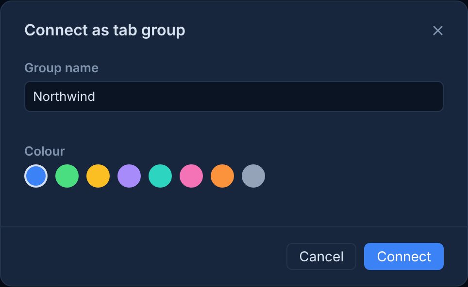

**Split view.** **Split pane right** and **Split pane down**, in a tab's right-click menu and in the Tab menu, open a second connection to the same place beside or under the first. Each pane has its own connection and asks for its own login. Drag the bar between the panes to resize them. **Show beside: <tab>** puts another open tab, a serial console included, next to the current one without reconnecting either.

- The tab shows both panes. Each pane has a header with the session name and **Swap panes** and **Close pane** buttons, the pane being typed in is marked, and the divider is easier to see and grab.
- **Close pane** closes one pane. **Close split view** turns the split back into two tabs. Closing the tab closes both panes.
- A tab holds two panes at most. A serial port cannot be split, but it can be shown beside another tab.
- The command window's **Visible panes** option sends to both panes.

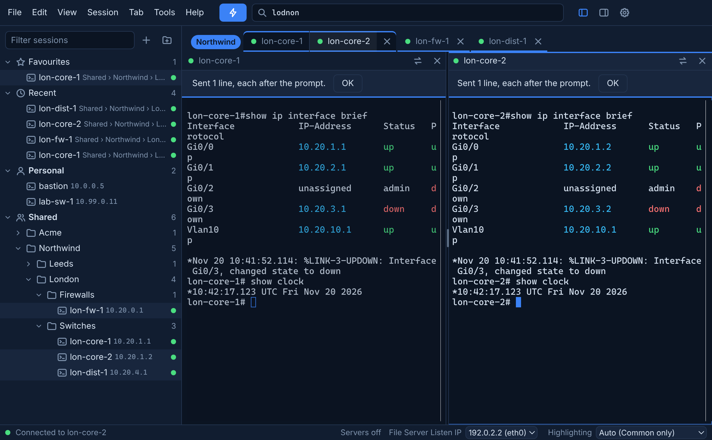

### Command window

**View > Command window** opens an input box at the bottom of the window. Its target is one of:

- **Visible panes:** the visible tab, or both panes of a split tab,
- the tab group of the visible tab,
- all active sessions.

The radio buttons name the target and the number of tabs, for example `Tab group: Northwind (4)` or `Visible panes (2)`. Enter sends. Shift+Enter adds a line. Up and Down recall earlier commands. **Wait for the prompt after each line** holds each line until the device prompt returns. Disconnected tabs are skipped and the window reports how many.

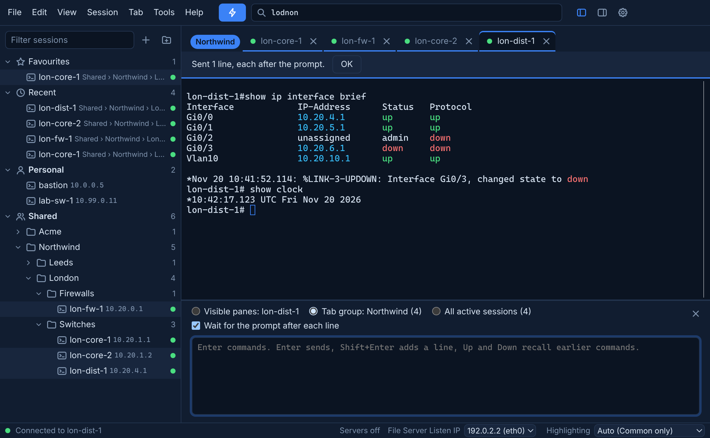

### Highlight rules

Device output is coloured as it arrives. Rules cover IP addresses, interface up and down states, warnings and errors, ping loss, BGP and OSPF neighbour states, `[confirm]` prompts, and `reload` and `erase`. Rule sets exist for Cisco, Comware, Aruba, Junos and FortiOS, plus a common set that always applies.

The rule set is selected from the device's output. The **Highlighting** menu in the status bar shows the active set and switches it.

**Follows the prompt.** On **Auto**, the rule set follows the prompt after login, not only at login. A session that logs in to a Linux host and hops from there to a FortiGate (or a Junos or Comware device) switches to that device's rules once its prompt appears, and goes back to the common set when a shell prompt returns. A set picked by hand from the Highlighting menu never changes.

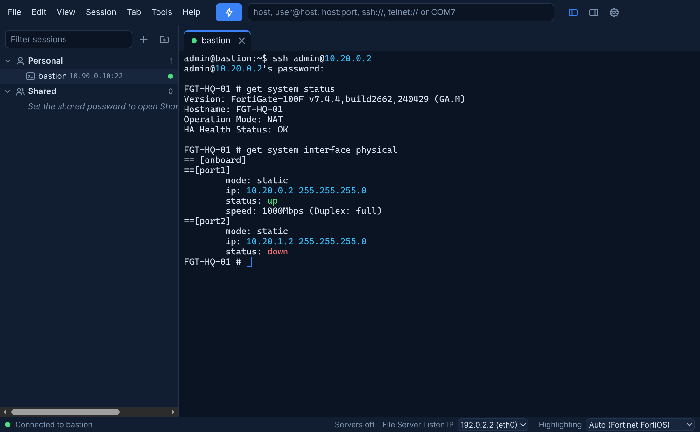

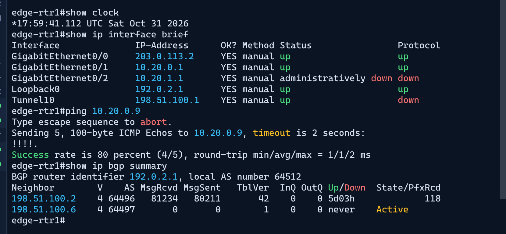

### Terminal appearance

Colour scheme, font, font size, bold and cursor style are set per session under **Edit session > Advanced**, and for new sessions in **Session > Default session…**. A session that does not set a value follows the Default session.

- **Colour schemes:** ConnSmith Dark Blue, Light, Solarized Dark, Classic (white on black), Graphite Orange and Matrix. The highlight colours follow the scheme.
- **Font:** a drop-down of Cascadia Mono, Cascadia Code, Courier, Courier New, Lucida Console and MS Gothic, each shown in its own face. Fonts that are not installed on the PC fall back to Consolas. Cascadia Mono is bundled with ConnSmith.
- **Font size:** the even sizes from 8 to 24. The default is 14.
- **Bold:** a tick box that sets the bold weight for all text.
- The built-in choice in each drop-down is marked **(Default)**.
- **Zoom:** **View > Zoom in**, **Zoom out** and **Reset zoom** (Ctrl+=, Ctrl+- and Ctrl+0) change the font size of the tab in front by two pixels and save it into its session. **View > Theme** lists the colour schemes.

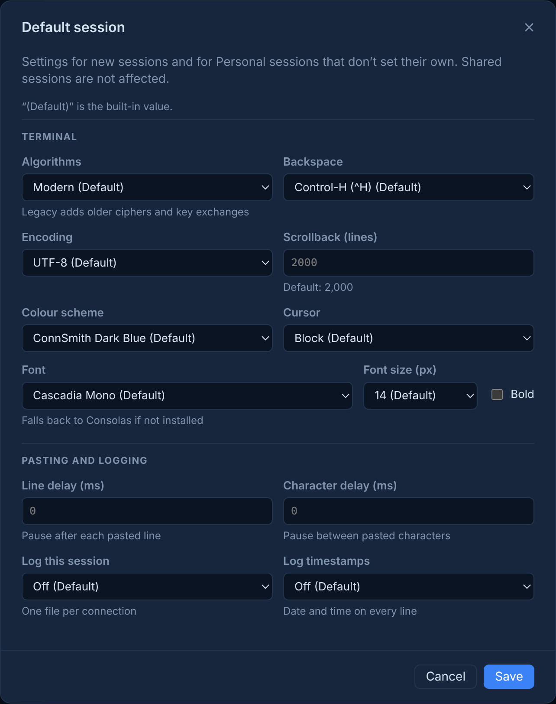

Graphite Orange (orange on grey) and Matrix (green on black):

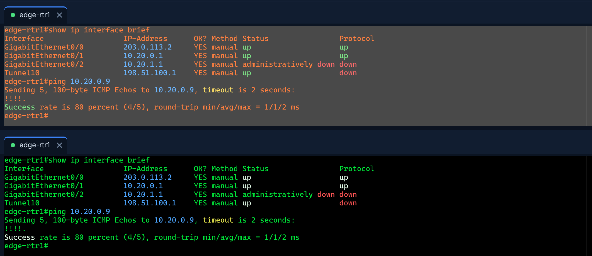

### Find

**Ctrl+Shift+F** searches the scrollback of the current tab, with case-sensitive and regular expression options. Every match is also marked in a strip beside the scrollbar, showing where matches fall in a long output.

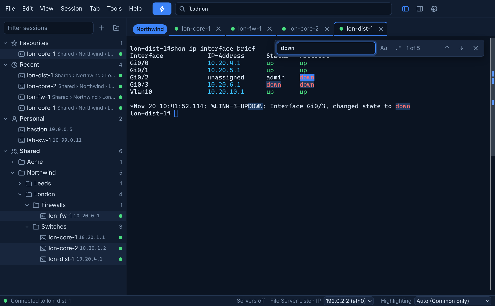

### File servers: TFTP, FTP and SFTP/SCP

**Tools > File servers** opens a panel with three servers that serve one shared folder (the Downloads folder by default, changed in **Settings > File servers**).

| Server | Default port | Typical use |
| --- | --- | --- |
| TFTP | UDP 69 | Firmware and configuration transfer for switches and access points |
| SCP / SFTP | TCP 22 (2222 if 22 is in use) | Devices that use `scp` or `sftp`, such as FortiGate |
| FTP | TCP 21 (passive range 50000-50100) | Devices that support FTP only, such as Cisco `copy ftp:` |

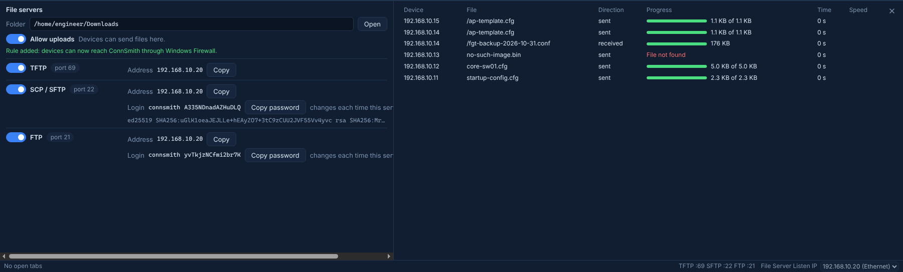

- The **File Server Listen IP** in the status bar selects the address the servers bind to, or **All interfaces**.
- The panel shows each server's address and, for SFTP and FTP, the login and a password generated each time the server is switched on.
- The folder is read-only until **Allow uploads** is switched on. The switch resets at every start. Devices cannot delete files or directories.
- Each transfer is listed with device, file, progress and speed. Refused requests are listed with the reason.
- **Ports:** **Settings > File servers** sets a port for each server and a second port that is tried when the first is taken. The panel shows the port in use. **Save ports** applies a change and updates the Windows Firewall rules at once, after one administrator approval. Leaving Settings with unsaved port changes asks first.
- **Allow in Windows Firewall** adds inbound rules for the ports in use only, after one administrator prompt. If Windows refuses, the panel says why and shows the equivalent `netsh` command.
- SFTP refuses a request to append to a file, because uploads are stored whole, instead of quietly replacing it. TFTP serves a request that a device repeats before the first answer once, so no failed row appears beside the good one.

### SecureCRT import

**File > Import SecureCRT sessions…** reads the SecureCRT sessions folder and shows its folders and SSH and Telnet sessions as a tree of tick boxes. **Tick all**, **Tick none**, **Collapse all** and **Expand all** act on the whole tree. The ticked sessions are added to the Personal store with the same folder structure. SecureCRT's own files are not modified, and sessions that already exist in ConnSmith are not changed.

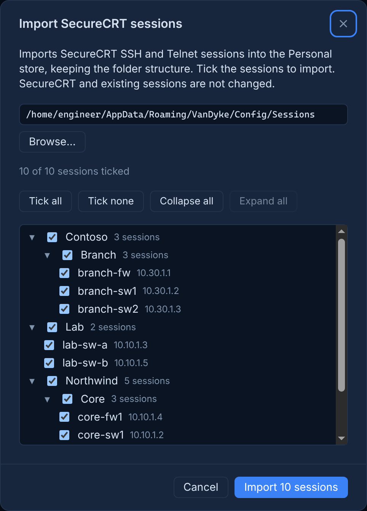

The final page offers **Move to Shared…**, which opens the wizard that assigns a client and device type to each folder and moves the sessions that pass the share checks.

### SSH keys

**Settings > SSH keys** holds the private keys that sessions can log in with. A key chosen in **Edit session** is tried before the password, and the password prompt follows if the device refuses it. Keys stay in their original files and are never copied into sessions or the Shared store. A Shared session never holds a key: each PC picks its own key for the session.

- **Add key…** accepts OpenSSH and PEM private keys and PuTTY `.ppk` files: version 2 RSA, and version 3 (PuTTY 0.75 and later) RSA, ECDSA and ed25519, with or without a passphrase. No conversion in PuTTYgen is needed.
- **Generate key…** makes an Ed25519 or RSA 4096 key, with an optional passphrase and comment. The private key is saved to a file chosen in the save dialog, with the public key beside it as `.pub`. Existing files are never overwritten. The new key is added to the list straight away.
- **Copy public key** puts the public key line on the clipboard, ready to paste into the device's authorized keys.
- The passphrase can be saved on the PC, protected by the Windows login. Removing a key does not delete its file. Sessions that used it go back to password login.

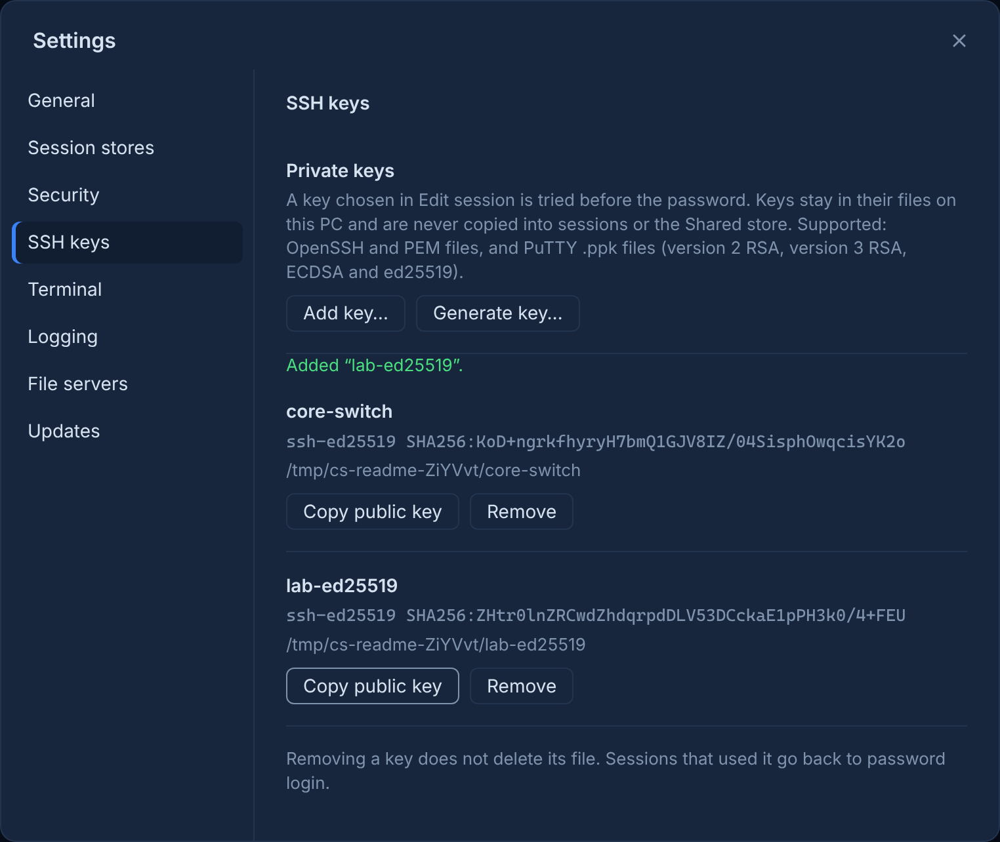

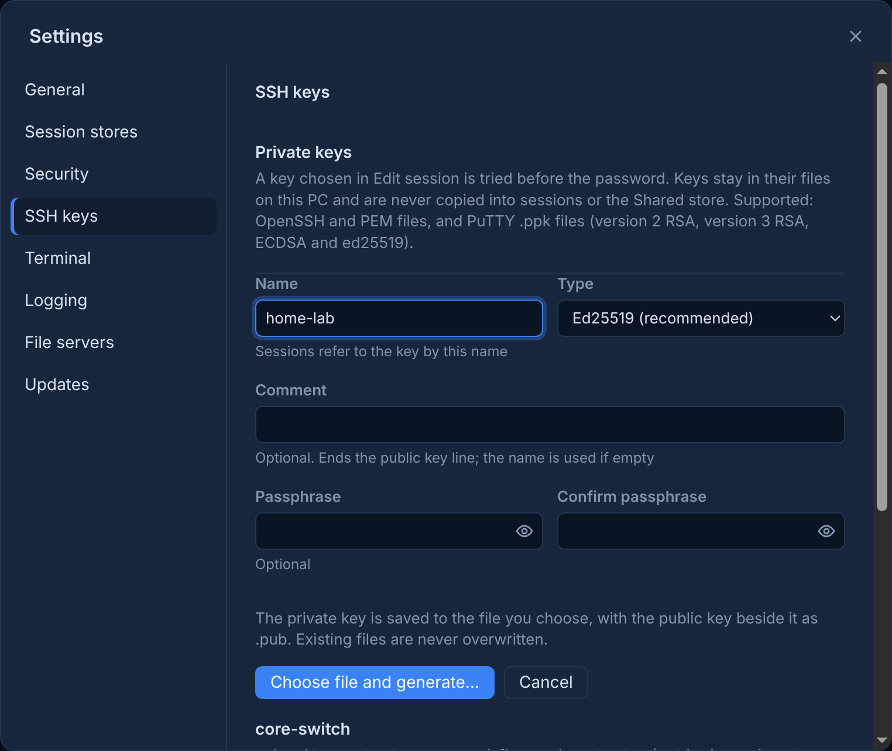

---

## New session and Edit session

**Session > New session…** and **Edit session** keep the common fields in view: name, protocol, host, port, username and login key. Everything else sits behind **Advanced**, which opens by itself when the session already uses one of its settings:

- Jump host and port forwards (SSH),
- the inherited terminal settings (algorithms, backspace, encoding, scrollback, colours, font and cursor),
- pasting and logging settings.

A setting left blank follows the Default session.

### Jump host

**Edit session > Advanced > Jump host** lists the saved SSH sessions. When one is chosen, ConnSmith logs in to it first, with its own saved password, key and settings, and opens the connection to the device through it. Use it for devices that are reachable only from a bastion or management host.

- The host key and login questions of the jump host are titled **Jump host**. The connection info panel shows it on the **Via** line.
- One hop only.
- A Shared session can use only a Shared session as its jump host, and a session moves to Shared only once its jump host is there.

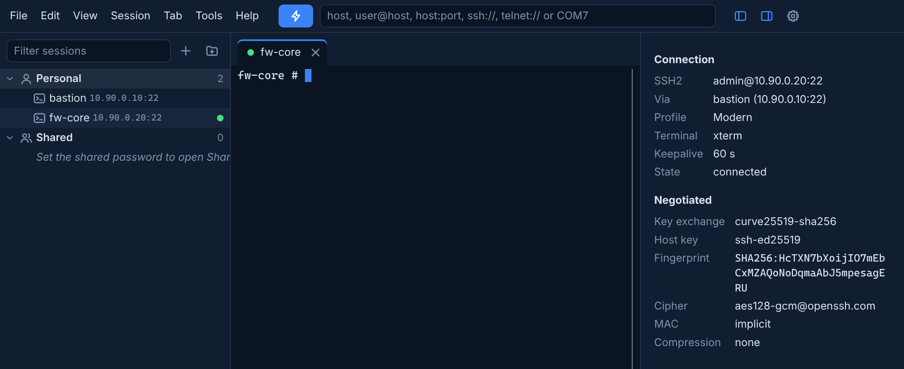

## Other features

- **Session logging** to a file with a templated path, started from the tab menu or automatically per session. **Settings > Logging** has a switch that adds the date and time to every log line. Logs can hold device configuration, so keep the log folder out of any synced or shared folder.
- **Paste protection:** pastes are shown for confirmation first and can be sent line by line with per-session line and character delays. A single line break at the end of a pasted command is dropped, so Enter stays with the user.
- **Hostname check:** when the device prompt differs from the saved session name, ConnSmith offers to update the session. A switch in **Settings > Terminal** turns the offer off.
- **Command palette** (Ctrl+Shift+P) for all menu actions.
- **One window:** starting ConnSmith while it is already open brings the open window forward instead of starting a second copy.
- **Pop-ups:** short pop-ups confirm that an address, username or password was copied, that a session was saved from Quick Connect, and that logging started or stopped. The COM port pop-up is smaller and slides in.
- **Motion:** buttons, menus and dialogs have a little motion and clearer keyboard focus. Motion is skipped when Windows animation effects are off.

## Reporting problems

Send issues to Matt with the ConnSmith version, shown in **Settings > Updates**.
